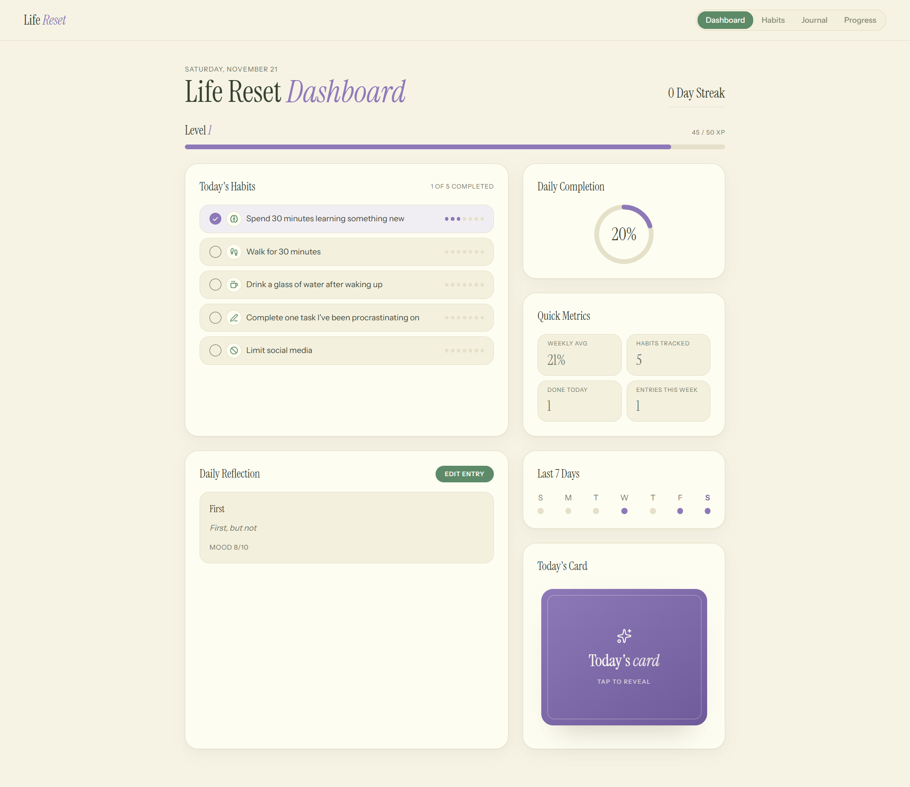
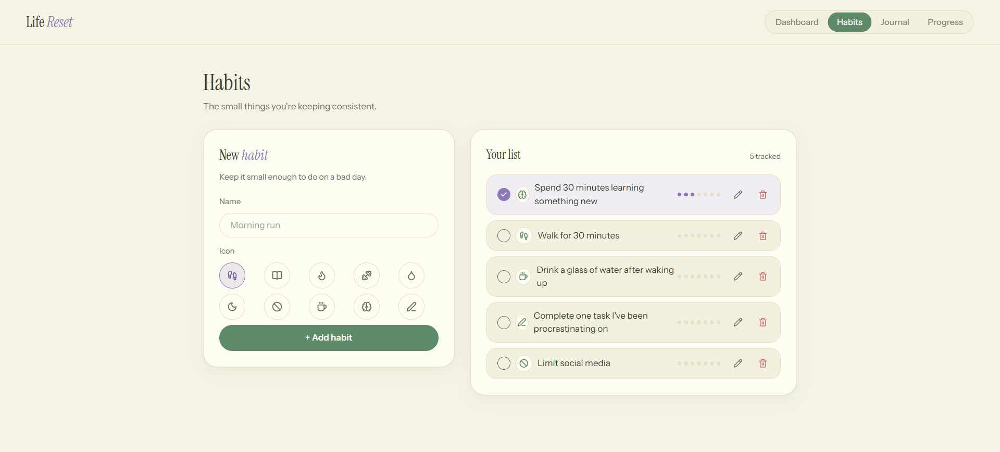
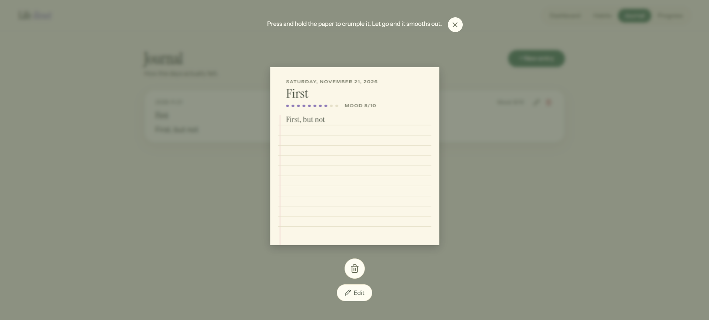
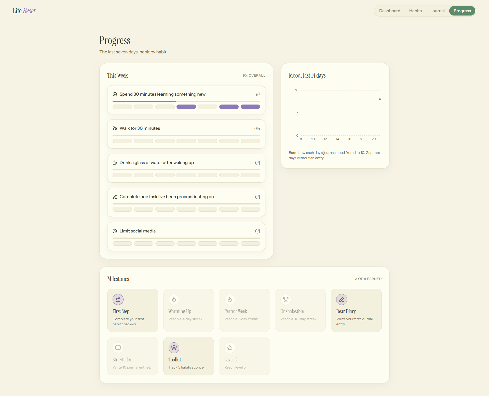
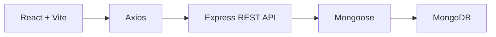

# Life Reset Dashboard

Life Reset is a full-stack personal productivity dashboard designed to help users build consistent daily routines, track personal growth, and reflect on their progress.

It combines habit tracking, journaling, and gamified progress features into one interactive experience, built using the MERN stack.


## Screenshots
<div align="center">

<table>
  <tr>
    <td align="center" width="50%">
      
      <br />
      <b>Dashboard</b>
    </td>
    <td align="center" width="50%">
      
      <br />
      <b>Habit Management</b>
    </td>
  </tr>
  <tr>
    <td align="center" width="50%">
      
      <br />
      <b>Journal</b>
    </td>
    <td align="center" width="50%">
      
      <br />
      <b>Progress Tracking</b>
    </td>
  </tr>
</table>

</div>

## Features

- **Dashboard** — daily progress %, current streak, today's habit checklist, today's journal preview, level and XP bar, weekly metrics, today's journal preview, and a flip-to-reveal daily card (affirmation, fun fact or food pairing)
- **Habits** — create, complete/incomplete, edit, delete
- **Journal** — daily entries with mood rating (1–10), full CRUD
- **Progress** — weekly completion stats per habit, computed from stored history
- **XP and levels**: every habit check-in earns 10 XP and every journal entry earns 15 XP. Levels follow `floor(sqrt(XP / 50)) + 1`
- **Milestone badges**: earned automatically from your history (first check-in, 3/7/30-day streaks, journal milestones, habit count, level 5)
- **Sticky navigation** with an animated, draggable segmented control


## Tech Stack

**Frontend:** React (Vite), React Router, Axios, Three.js, Lucide React <br>
**Backend:** Node.js, Express<br>
**Database:** MongoDB (Mongoose)

## Architecture


XP, levels, streaks and badges are **derived on the client** from stored completion history and journal entries. There is no extra database state to keep in sync.

## How XP and badges work

| Action             | XP  |
|--------------------|-----|
| Habit check-in     | 10  |
| Journal entry      | 15  |

| Level | Total XP required |
|-------|-------------------|
| 1     | 0                 |
| 2     | 50                |
| 3     | 200               |
| 4     | 450               |
| 5     | 800               |

Streaks count a day only if every habit that existed on that day was completed.

## API Endpoints

| Method | Endpoint          | Description         |
|--------|-------------------|----------------------|
| GET    | /api/habits       | List all habits      |
| POST   | /api/habits       | Create a habit        |
| PUT    | /api/habits/:id   | Update/toggle a habit |
| DELETE | /api/habits/:id   | Delete a habit        |
| GET    | /api/journal      | List journal entries  |
| POST   | /api/journal      | Create an entry       |
| PUT    | /api/journal/:id  | Update an entry       |
| DELETE | /api/journal/:id  | Delete an entry       |

## Running Locally

### Prerequisites
- Node.js
- MongoDB running locally (or a MongoDB Atlas connection string)

### Backend
```bash
cd backend
npm install
# create a .env file with:
# PORT=5000
# MONGO_URI=mongodb://127.0.0.1:27017/lifeResetDashboard
npm run dev
```

### Frontend
```bash
cd frontend
npm install
npm run dev
```

Visit `http://localhost:5173`.

## Known Limitations (V1)

- XP is derived from history, so deleting a habit also removes the XP it earned
- Dates are stored as local `YYYY-MM-DD` strings generated in the browser, so history can look shifted if you change time zones
- No authentication; the app is single-user
- Daily cards and their flipped state are stored in `localStorage` and are not synced across devices

## Roadmap

- Study targets with daily and weekly goals, session tracking, and progress analytics
- Collectible daily card collection
- Habit schedules (specific days of the week)
- Data backup and restore.