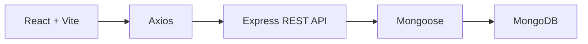

# Life Reset Dashboard

A full-stack personal productivity dashboard for tracking daily habits, journaling, and weekly progress with XP, levels and milestone badges. Built to learn and demonstrate the MERN stack (MongoDB, Express, React, Node.js).

## Features

- **Dashboard** — daily progress %, current streak, today's habit checklist, today's journal preview, level and XP bar, weekly metrics, today's journal preview, and a flip-to-reveal daily card (affirmation, fun fact or food pairing)
- **Habits** — create, complete/incomplete, edit, delete
- **Journal** — daily entries with mood rating (1–10), full CRUD
- **Progress** — weekly completion stats per habit, computed from stored history
- **XP and levels**: every habit check-in earns 10 XP and every journal entry earns 15 XP. Levels follow `floor(sqrt(XP / 50)) + 1`
- **Milestone badges**: earned automatically from your history (first check-in, 3/7/30-day streaks, journal milestones, habit count, level 5)
- **Sticky navigation** with an animated, draggable segmented control


## Tech Stack

**Frontend:** React (Vite), React Router, Axios, Three.js, Lucide React <br>
**Backend:** Node.js, Express<br>
**Database:** MongoDB (Mongoose)

## Architecture


XP, levels, streaks and badges are **derived on the client** from stored completion history and journal entries. There is no extra database state to keep in sync.

## How XP and badges work

| Action             | XP  |
|--------------------|-----|
| Habit check-in     | 10  |
| Journal entry      | 15  |

| Level | Total XP required |
|-------|-------------------|
| 1     | 0                 |
| 2     | 50                |
| 3     | 200               |
| 4     | 450               |
| 5     | 800               |

Streaks count a day only if every habit that existed on that day was completed.

## API Endpoints

| Method | Endpoint          | Description         |
|--------|-------------------|----------------------|
| GET    | /api/habits       | List all habits      |
| POST   | /api/habits       | Create a habit        |
| PUT    | /api/habits/:id   | Update/toggle a habit |
| DELETE | /api/habits/:id   | Delete a habit        |
| GET    | /api/journal      | List journal entries  |
| POST   | /api/journal      | Create an entry       |
| PUT    | /api/journal/:id  | Update an entry       |
| DELETE | /api/journal/:id  | Delete an entry       |

## Running Locally

### Prerequisites
- Node.js
- MongoDB running locally (or a MongoDB Atlas connection string)

### Backend
```bash
cd backend
npm install
# create a .env file with:
# PORT=5000
# MONGO_URI=mongodb://127.0.0.1:27017/lifeResetDashboard
npm run dev
```

### Frontend
```bash
cd frontend
npm install
npm run dev
```

Visit `http://localhost:5173`.

## Known Limitations (V1)

- XP is derived from history, so deleting a habit also removes the XP it earned
- Dates are stored as local `YYYY-MM-DD` strings generated in the browser, so history can look shifted if you change time zones
- No authentication; the app is single-user
- Daily cards and their flipped state are stored in `localStorage` and are not synced across devices

## Roadmap

- Study targets with daily and weekly goals, session tracking, and progress analytics
- Collectible daily card collection
- Habit schedules (specific days of the week)
- Dark mode