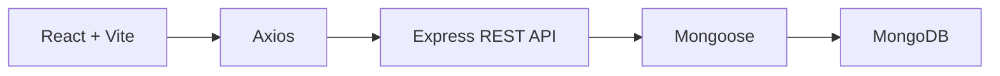

# Life Reset Dashboard

A full-stack personal productivity dashboard for tracking daily habits, journaling, and weekly progress — built to learn and demonstrate the MERN stack (MongoDB, Express, React, Node.js).

## Features

- **Dashboard** — daily progress %, current streak, today's habit checklist, today's journal preview
- **Habits** — create, complete/incomplete, edit, delete
- **Journal** — daily entries with mood rating (1–10), full CRUD
- **Progress** — weekly completion stats per habit, computed from stored history

## Tech Stack

**Frontend:** React (Vite), React Router, Axios <br>
**Backend:** Node.js, Express<br>
**Database:** MongoDB (Mongoose)

## Architecture



## API Endpoints

| Method | Endpoint          | Description         |
|--------|-------------------|----------------------|
| GET    | /api/habits       | List all habits      |
| POST   | /api/habits       | Create a habit        |
| PUT    | /api/habits/:id   | Update/toggle a habit |
| DELETE | /api/habits/:id   | Delete a habit        |
| GET    | /api/journal      | List journal entries  |
| POST   | /api/journal      | Create an entry       |
| PUT    | /api/journal/:id  | Update an entry       |
| DELETE | /api/journal/:id  | Delete an entry       |

## Running Locally

### Prerequisites
- Node.js
- MongoDB running locally (or a MongoDB Atlas connection string)

### Backend
```bash
cd backend
npm install
# create a .env file with:
# PORT=5000
# MONGO_URI=mongodb://127.0.0.1:27017/lifeResetDashboard
npm run dev
```

### Frontend
```bash
cd frontend
npm install
npm run dev
```

Visit `http://localhost:5173`.

## Known Limitations (V1)

- Streak calculation resets if a new habit is added mid-streak, since it requires history for every tracked habit
- Dates are handled in UTC, which can cause an off-by-one near midnight in some timezones
